# Software Engineering - Assignment #06

AI-enabled software engineering, agentic code review, security, code-based vs low-code: **Lab Equipment Loan Checker**

- **Full Name:** Bakir Didar
- **Student ID:** 24B031711
- **Group / practice lessons:** Thursdays, 14:00-17:00 (Lesson #11 practice: 19 November 2026; Lesson #12 practice: 26 November 2026)
- **Assignment:** #06
- **Chosen application:** Lab Equipment Loan Checker (fictional Electronics Lab 204, inventory checker)
- **Source code (GitHub):** https://github.com/didarrr1/lab-loan-checker
- **Live demo, code-based (GitHub Pages):** https://didarrr1.github.io/lab-loan-checker/
- **Live demo, low-code (Appsmith, public):** https://app.appsmith.com/app/lab-equipment-loan-checker-low-code-1/page1-6b092b8e5f8a097fcfb17699
- **AI assistant:** Claude Code (Claude desktop app, Code tab), model Claude Opus 5.5 (`claude-opus-5-5`), used as the coding agent; a separate read-only Claude Opus 5.5 sub-agent as the code reviewer. Date of use: 27 November 2026.
- **Environment:** Windows 11, Node.js v22.23.5 (portable, no packages installed), Git 2.56, built-in browser of the Claude app; Appsmith Cloud, free plan; GitHub Pages.

---

## 1. Result in brief
| Item | Result |
|---|---|
| Feature | One loan-request check: item + quantity + loan days -> Approved / Rejected / Invalid input + reason code |
| Contract | 202-word description, AC1-AC6, inputs/outputs, 12 shared test cases written before any implementation (commit `153f753`) |
| Code-based | plain HTML + JavaScript modules, 0 dependencies, 4 layers; **12/12** shared cases in the browser; **35/35** automated tests |
| Low-code | Appsmith: 10 widgets, 1 API query, 1 JS object (46 lines); **12/12** shared cases after one fix (T12 failed first) |
| Agentic review | 10 candidate findings from a read-only reviewer + 1 sub-claim: **8 confirmed**, 2 plausible/unverified, 1 unsupported |
| Fixes | 9 issues fixed in the code track, tests written first (11 new tests failed on v1, then passed); 1 low-code defect fixed |
| Security | XSS found and fixed in code (confirmed by a browser probe); low-code Text widget renders HTML from data, scripts blocked by the platform |
| Recommendation | **code-based**; release decision **Ready with conditions** (Section 9) |

## 2. Task #01 - Baseline and requirements
**Baseline (preserved).** Commit `415d944`: a catalog page that only lists the four fictional items. It cannot say
whether a request is allowed.

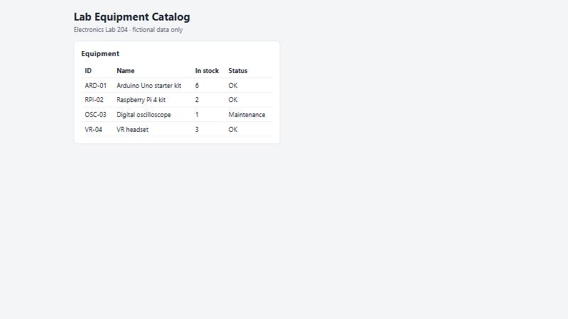

**User, problem, feature and scope (202 words).** A KBTU student wants to borrow equipment from the fictional
Electronics Lab 204 for a course project. Today the page only shows a table, so students go to the lab and are turned
away: an item is under maintenance, there are not enough units, or they ask for too many units or days. The feature
is a loan-request checker: the student chooses an item, types a quantity and a number of days and presses "Check
request". The page answers Approved, Rejected or Invalid input, shows a reason code and one clear sentence, and
confirms that the stock was not changed. It only checks; it never reserves or stores anything. The catalog is a
fixed fictional JSON file (`data/catalog.json`) that both implementations load. Out of scope: login, real student data,
payments, a database, e-mail, an LLM feature and staff screens. (Full text: `docs/contract.md`.)

**Acceptance criteria (observable)**
| ID | Criterion | Reason code(s) |
|---|---|---|
| AC1 | A valid request for an item not under maintenance with quantity <= stock is **Approved** | `APPROVED` |
| AC2 | Quantity 1-5 and loan days 1-14 (whole numbers); outside -> **Invalid input** | `QUANTITY_OUT_OF_RANGE`, `DAYS_OUT_OF_RANGE` |
| AC3 | Item under maintenance or quantity > stock -> **Rejected** | `ITEM_UNAVAILABLE`, `INSUFFICIENT_STOCK` |
| AC4 | No / unknown item, empty / text / decimal numbers -> **Invalid input** naming the field | `INVALID_ITEM`, `INVALID_QUANTITY`, `INVALID_DAYS` |
| AC5 | Checking never changes the catalog; repeating a check gives the same result | (all) |
| AC6 | Catalog cannot be loaded -> clear error, check button disabled, no decision | `CATALOG_UNAVAILABLE` |

**Inputs, outputs, example data.** Inputs: item (selection), quantity (text), loan days (text). Catalog: ARD-01
Arduino kit stock 6; RPI-02 Raspberry Pi kit stock 2; OSC-03 oscilloscope stock 1, maintenance; VR-04 VR headset
stock 3. Outputs: decision, reason code, one-sentence message, "Stock unchanged: yes (n checks)". Order of checks:
catalog -> item -> quantity format -> days format -> quantity range -> days range -> maintenance -> stock -> approved.

**Architecture / workflow overview**
```
            data/catalog.json  (one fictional file, served by GitHub Pages)
              |                                   |
   code-based track                        low-code track (Appsmith)
   src/catalog.js  load + validate + freeze   GetCatalog  REST API query, runs on page load
   src/validation.js  parse raw input         Checker.whole()  (JS object)
   src/rules.js  checkLoan() decision         Checker.check()  same rules, same order
   src/ui.js + index.html  textContent output  Text widgets + Table + Select bound to Checker
   tests/*.test.js  35 automated tests        manual runs of the 12 shared cases
```

## 3. Task #02 - Code-based implementation
| Layer | File | Responsibility |
|---|---|---|
| Input validation | `src/validation.js` (38 lines) | `parseWholeNumber` accepts only `^\d{1,6}$`; `validateRequest` returns a typed request or a reason |
| Core logic | `src/rules.js` (36 lines) | `checkLoan(raw, catalog)` pure function, decisions, messages |
| Data | `src/catalog.js` (22 lines) | fetch, HTTP status and shape check, `Object.freeze` |
| Output | `src/ui.js` (62 lines), `index.html`, `styles.css` | form, result, catalog table; `textContent` only; CSP; one column below 700 px |

**Build and run.** No build step and nothing to install: `npm test` (Node's built-in test runner) and `npm start`
(static server on 127.0.0.1:5186). The same files are served by GitHub Pages.

**AI prompts, substantive edits and my decisions** (full log in Appendix A)
- The agent wrote the contract and the shared cases first and committed them before any code (`153f753`).
- v1 (`7c74b3d`) was generated by the agent: 20 tests passed. It still contained the defects found later in review
  (for example `innerHTML` in `ui.js`), which is exactly why a separate review step was needed.
- Decisions: text inputs instead of number inputs (so that 0, 6, "two" and decimals can be tested); one catalog file
  for both tracks; a frozen catalog (AC5); "No decision" as a fourth state for AC6 (after review R5).

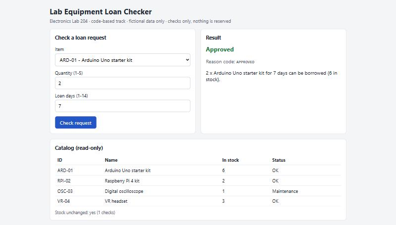
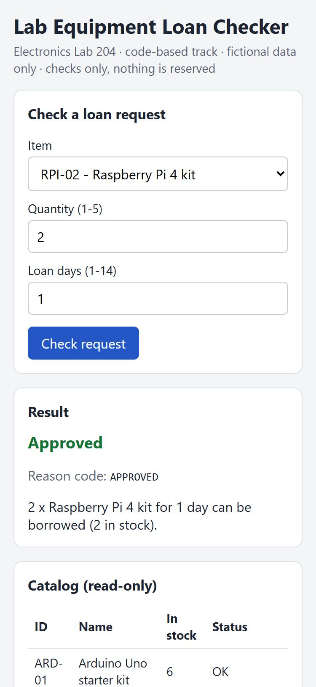

## 4. Task #03 - Low-code implementation (Appsmith)
**Configuration.**
- **Inputs:** `ItemSelect` (Select, options bound to the catalog), `QuantityInput` and `DaysInput` (Input, text type).
- **Rules:** JS object `Checker` with the same rules and order (`lowcode/Checker.js`).
- **Data:** API query `GetCatalog` -> `https://didarrr1.github.io/lab-loan-checker/data/catalog.json`, run on page load.
- **Outputs:** Text widgets bound to `Checker.result`, an integrity line, `CatalogTable`.
- **Button:** `CheckButton`, onClick `Checker.run()`, Disabled `{{!Checker.catalog()}}`.

**How it was built.** The editor's drag-and-drop does not work with the agent's synthetic mouse events. So the widgets
and the JS object were written as an Appsmith import file. The file was generated by `lowcode/make_import.py`, using
the structure of my own Practice #13 export as a template. It was imported through the official "Import" dialog. The
API query, "run on page load", the Disabled binding and the publish were then configured in the editor by hand.

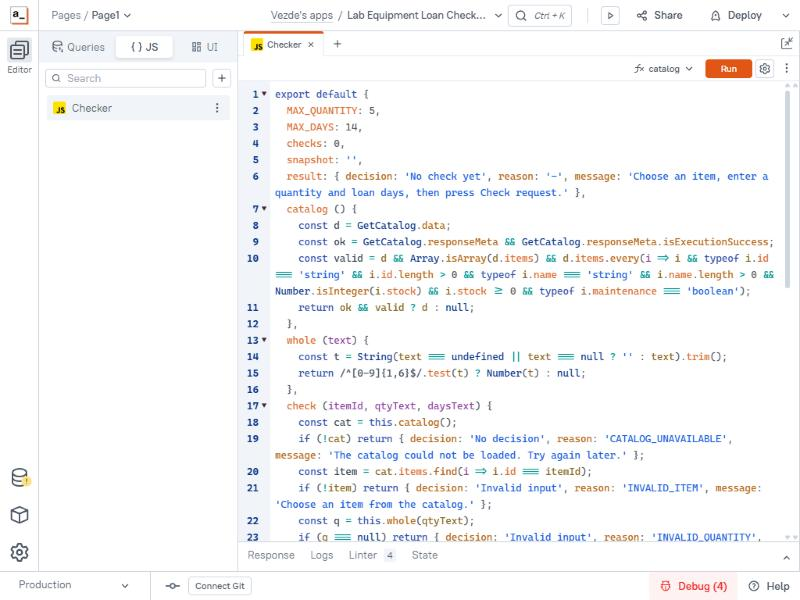
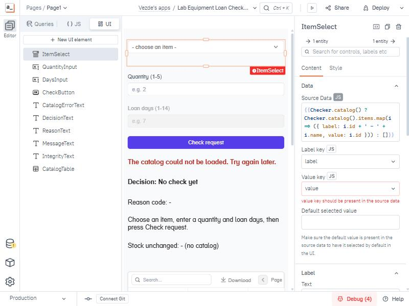
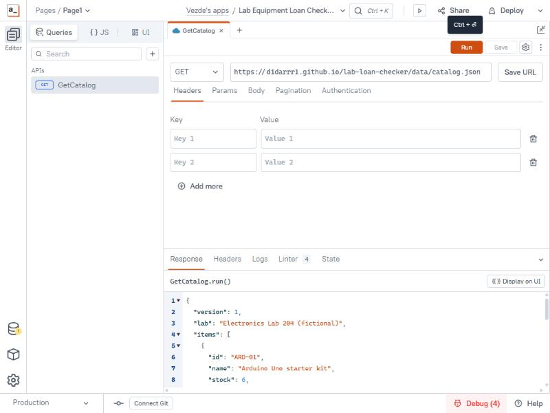

**Platform restrictions and workarounds (free plan, no subscription bought)**
| Restriction | Workaround |
|---|---|
| Rules (ordered validation, reason codes) cannot be expressed with widget settings alone | 46-line JS object: this is **low-code, not no-code** |
| No automated test runner | the 12 shared cases were run by hand in the deployed app |
| Application-level access needs the Business plan; roles are workspace-wide | app kept in a personal workspace; made public only for the demo |
| Drag-and-drop not usable by the agent | import file + editor configuration (described above) |
| Imported "Disabled" expression was not in JS mode (defect L1) | switched to JS in the editor; `make_import.py` now writes `dynamicPropertyPathList` |

**Nothing is mocked or simulated:** both tracks load the real `catalog.json` over HTTPS, and T12 used a real HTTP 404.

## 5. Task #04 - Common test suite (prepared before implementation)
Expected values come from `docs/contract.md` / `tests/cases.json` (commit `153f753`). Observed = what the screen showed.

| ID | Category | Input (item, qty, days) | Expected | Code-based observed | Low-code observed | Pass/Fail |
|---|---|---|---|---|---|---|
| T1 | normal | ARD-01, 2, 7 | Approved / APPROVED | Approved / APPROVED | Approved / APPROVED | Pass / Pass |
| T2 | boundary max | ARD-01, 5, 14 | Approved | Approved | Approved | Pass / Pass |
| T3 | boundary qty 6 | ARD-01, 6, 7 | Invalid / QUANTITY_OUT_OF_RANGE | same | same | Pass / Pass |
| T4 | boundary days 15 | ARD-01, 1, 15 | Invalid / DAYS_OUT_OF_RANGE | same | same | Pass / Pass |
| T5 | qty = stock, min days | RPI-02, 2, 1 | Approved | Approved ("1 days" in v1, "1 day" after R10) | Approved ("1 day") | Pass / Pass |
| T6 | stock rule | RPI-02, 3, 7 | Rejected / INSUFFICIENT_STOCK | same | same | Pass / Pass |
| T7 | maintenance | OSC-03, 1, 3 | Rejected / ITEM_UNAVAILABLE | same | same | Pass / Pass |
| T8 | invalid text | ARD-01, "two", 7 | Invalid / INVALID_QUANTITY | same | same | Pass / Pass |
| T9 | error feedback | (none), 1, 1 | Invalid / INVALID_ITEM | same | same | Pass / Pass |
| T10 | zeros, first rule | VR-04, 0, 0 | Invalid / QUANTITY_OUT_OF_RANGE | same | same | Pass / Pass |
| T11 | repeated operation | T1 three times | Approved each time, ARD-01 stock 6 | Approved, "unchanged: yes (13 checks)" | Approved, "unchanged: yes (13 checks)", table stock 6 | Pass / Pass |
| T12 | failure handling | catalog unreachable | error, button disabled, no decision | v1: error + disabled button, stale help text (R5); fixed: "No decision" + same message | first run: error shown but **button enabled**, stale decision kept (**Fail**, L1); after fix: button disabled | Pass / Fail -> Pass |

**Totals.** Code-based: 12/12 in the browser and 35/35 automated tests (`docs/evidence/T8_final_tests.txt`).
Low-code: 11/12 on the first run, 12/12 after the L1 fix. Every result above is a real run; nothing simulated was
counted.

```
$ npm test   (final run, 2026-11-27, node v22.23.5)
ℹ tests 35
ℹ suites 7
ℹ pass 35
ℹ fail 0
```

| Code-based | Low-code |
|---|---|
|  | 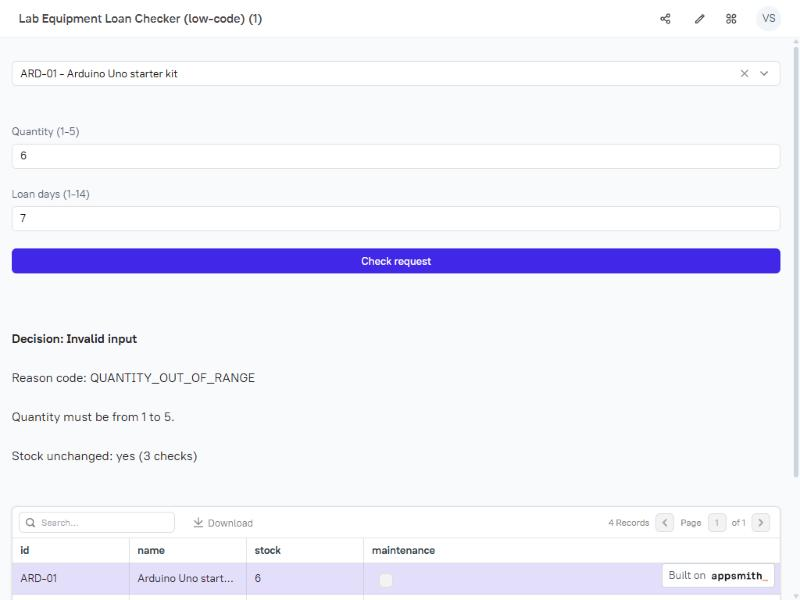 |
| 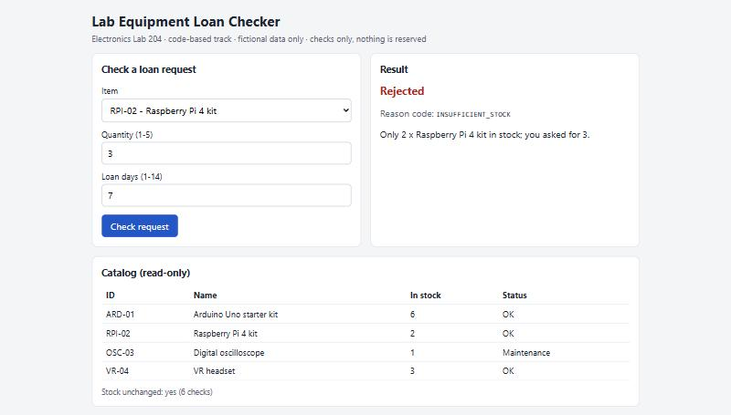 | 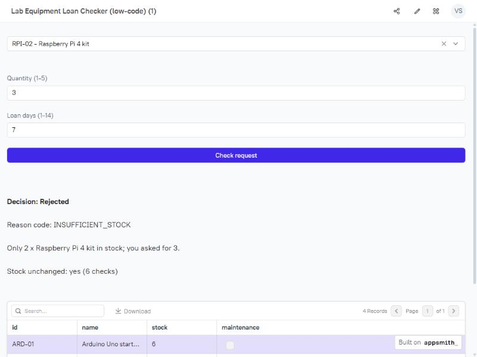 |
| 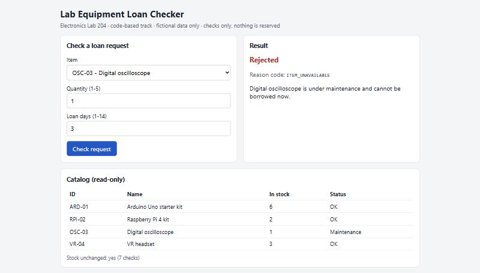 | 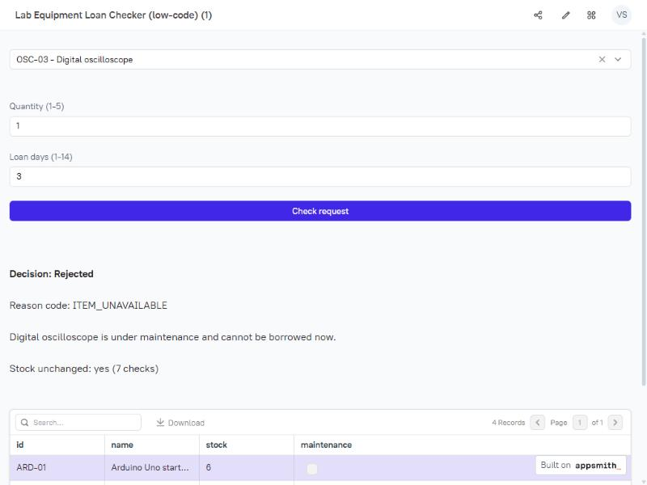 |
|  | 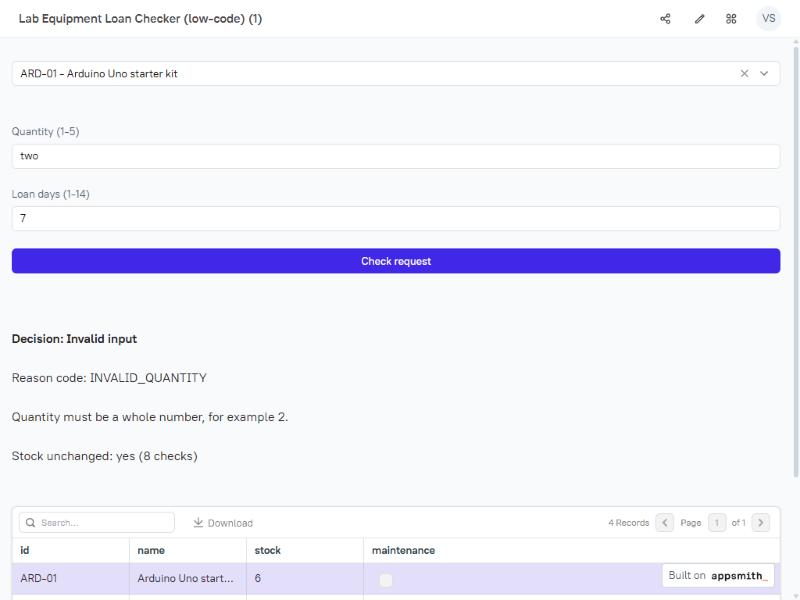 |
|  | 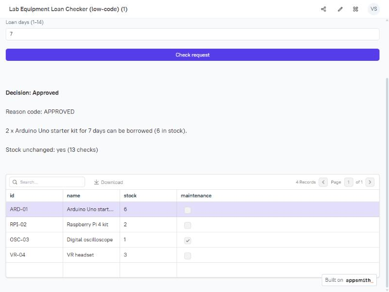 |
| 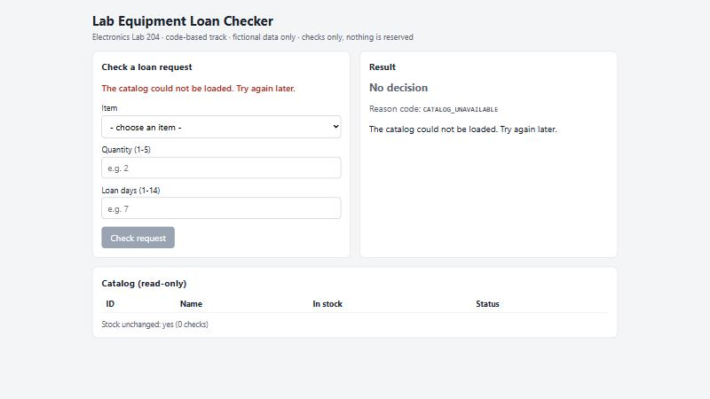 | 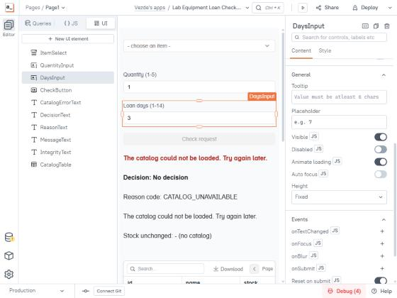 |

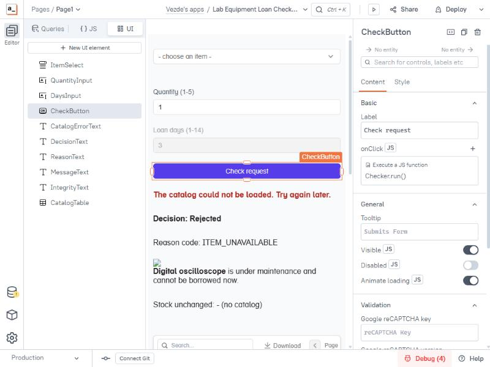

## 6. Task #05 - Agentic code review
**Setup.**
- A separate Claude Opus 5.5 sub-agent reviewed commit `7c74b3d`.
- **Instructions:** "do not edit, create, delete or rename any file … do not start servers".
- **Allowed:** reading files, running the tests and read-only `node -e` probes.
- **Afterwards:** `git status` showed no change by the reviewer.
- **Logs:** the raw report is in `docs/evidence/05a_ai_review_raw.md`.

| ID | Candidate finding (reviewer) | My verification (evidence) | Classification | Action |
|---|---|---|---|---|
| R1 | `ui.js:31` writes the message with `innerHTML`; `item.name` from the catalog is not escaped | Browser probe: a name `` changed the page title to "XSS-RAN" (screenshot 14) | **Confirmed** (high) | Fixed: `textContent`; static test; same probe after fix shows plain text (screenshot 15) |
| R2 | No Content-Security-Policy, no `nosniff` | `index.html` and `serve.js` inspected: none | **Confirmed** | Fixed: CSP meta + server headers (T5 log) |
| R3 | `catalog.js` ignores HTTP status and data shape | New tests: HTTP 500 JSON accepted, malformed items accepted (fail-first, T3 log) | **Confirmed** | Fixed: `response.ok` + schema check; 7 tests |
| R4 | Button enabled before the catalog loads; a check then shows "Stock unchanged: NO" | Logic confirmed (`JSON.stringify(null) !== ''`); not reproduced in the browser (no throttling) | **Plausible / unverified** | Fixed anyway (button `disabled` in HTML, guard in `show`) |
| R5 | AC6 says "no decision", but `checkLoan` returns "Invalid input"; stale help text | Screenshot 13 (v1) shows the stale "Choose an item…" text | **Confirmed** | Fixed: `DECISION.NONE`, one failure path; tighter T12 test |
| R6 | Dev server: `decodeURIComponent` outside `try`; `.git` served | `curl /%E0%A4%A` killed the server (`URIError`, T2 log); `/.git/config` returned 200 | **Confirmed** | Fixed: 400 on bad URL, dotfiles 404, GET/HEAD only; integration test |
| R6b | Possible path traversal through the dev server | Probes `/..%2f..%2f…`, `%2e%2e` gave 404 before and after; reviewer also found none | **Unsupported** | no change needed (resolve + prefix check added for clarity) |
| R7 | Testing gaps: no UI tests, `catalog.test.js` missing, no order-of-checks tests | Confirmed by inspection | **Confirmed** (partly fixed) | Added `catalog.test.js`, order and HTTP tests; UI automation remains a limitation |
| R8 | Decision strings duplicated in UI, error text duplicated | Inspection | **Confirmed** (low) | Fixed: `DECISION`, `MESSAGES` constants, lookup table |
| R9 | `renderCatalog` would duplicate `<option>`s if called twice | Not a bug today (called once) | **Plausible / unverified** | Fixed cheaply (rebuild the select) |
| R10 | "for 1 days" wording | node probe and T5 screenshot | **Confirmed** (low) | Fixed: singular/plural, test |

**Meaningful issues fixed:**
- R1 (XSS), R3 (accepting broken data) and R6 (one request crashes the server) are the three most important.
- For each fix the regression test was written first and failed on v1 (11 failures).
- After the fix it passed (35/35, `T4_after_fixes_tests.txt`).

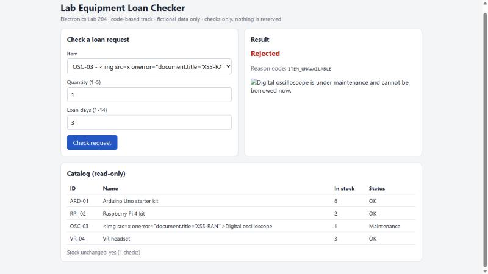
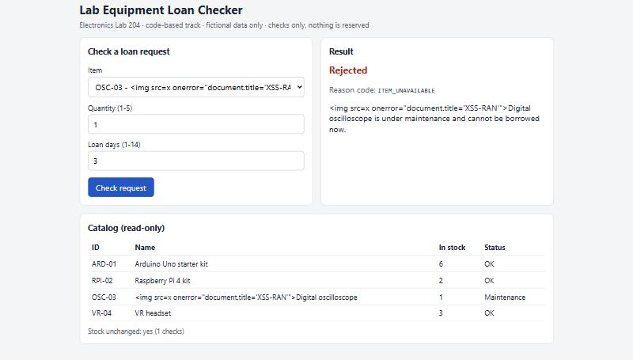

## 7. Task #06 - Security assessment
**Threat model**
| Element | Description |
|---|---|
| Assets | catalog integrity (correct stock and maintenance flags), availability of the checker, the GitHub account and Appsmith workspace, the student's credentials |
| Trust boundaries | browser <-> GitHub Pages (HTTPS); Appsmith app <-> Appsmith server <-> GitHub Pages (server-side API query); developer PC <-> GitHub (git + token); AI agent <-> files, shell and browser |
| Attack surfaces | form inputs (quantity, days, item value); `catalog.json` content (data rendered on screen); local dev server; public Appsmith URL; repository contents |
| Likely misuse | HTML/script in a catalog name (stored XSS if the data file is changed); malformed input to crash or confuse the page; reading `.git` or other files from a dev server; editing the low-code app through a shared workspace; leaking a token in the repo |

**SAST, DAST, SCA: what they are and what I applied**
| Check | Meaning | Applied to this project | Result |
|---|---|---|---|
| SAST (source inspection) | read the source without running it | AI review + `grep` for DOM sinks, `eval`, secrets, external URLs (`T6_sast_sca_checks.txt`); static tests in `catalog.test.js` | v1: `innerHTML` (R1); final: no sinks, no secrets, no external URLs |
| DAST (safe runtime checks) | probe the running app, only my own systems | local dev server probes (`T2`, `T5`), my GitHub Pages demo (`T7`), XSS probe catalogs in both tracks | v1 server crash + `.git` exposure fixed; Pages serves HTTPS + HSTS, `.git` 404, CSP meta present |
| SCA (dependency review) | review third-party packages and versions | `package.json`, `npm ls --all` | 0 dependencies, nothing to audit (`npm audit` needs a lockfile, and there is none because there are no packages); low-code platform dependencies are managed by Appsmith and cannot be inspected |

**Security checklist**
| Control | Code-based | Low-code (Appsmith) |
|---|---|---|
| Input validation | `^\d{1,6}$`, ranges, item must exist | same rules in `Checker` |
| Output encoding | `textContent` only, test enforces it | **Text widget renders HTML** from data: probe `<b>…</b>` rendered an image and bold text; the `onerror` script did **not** run (page title unchanged), so the platform sanitizes scripts but not markup (screenshot 34) |
| Injection / XSS | CSP `script-src 'self'`, no inline script | platform-controlled; cannot add own CSP |
| Data trust | catalog shape validated, rejected as a whole if broken | same validation in `Checker.catalog()` |
| Permissions / sharing | static public site, no accounts | public app = anyone with the link can use it; editing requires the workspace; app-level roles need a paid plan |
| Secrets | none in the repo (`git grep` check); the GitHub token was never written to a file or printed | no datasource credentials; the API is a public URL |
| Failure handling | 404 / bad JSON -> clear error, button disabled | 404 -> error text, button disabled (after L1 fix) |

**Agent tool permissions and prompt-injection exposure**
- **Coding agent (Claude Code):** could read and write files in my folder, run shell commands and drive the built-in
  browser, where I was signed in to Appsmith.
- **Outward steps:** I approved each one in the chat: the public GitHub repository and Pages, the public Appsmith app.
  The agent never typed a password.
- **GitHub token:** to create the repository, the agent used my existing git login through the GitHub API, only
  after I chose this option. The token was read from the git credential store into a shell variable and sent only to
  `api.github.com`.
- **Reviewer:** read-only by instruction, not by a sandbox. This was checked afterwards with `git status`, but it is not
  technically enforced.
- **Prompt injection:** the agents read `catalog.json`, web pages and Appsmith screens. Text in these files could
  contain instructions to the agent. The data is fictional and short, and agent output was always verified against
  tests and screenshots.
- **Two separate risks to keep apart:** the XSS probe file `data/probe-xss.json` is deliberately public and harmless
  (it only changes the page title). The real XSS risk comes from rendering data with `innerHTML`, not from the file.
- **No scanning beyond my own systems:** I probed only my local server, my GitHub Pages site and my own Appsmith app.

## 8. Task #07 - Comparison of the approaches
**Measured effort** (from `docs/evidence/timing.txt`; these are the AI agent's working times, a human would need much
longer, especially for drag-and-drop)
| Phase | Code-based | Low-code |
|---|---|---|
| Setup | ~0 min (Node already present, no packages) | included below |
| Setup + implementation | 1 min 15 s (11:31:14-11:32:29) | 28 min (11:41:16-12:09:21), includes waiting for my Appsmith/GitHub sign-in, repository creation and a second import because drag-and-drop failed |
| Testing (shared cases) | 1 min (11:32:29-11:33:30) + automated tests in seconds | 3 min (12:09:21-12:12:23) for T1-T11, all manual |
| Review + debugging + fixing | 6.5 min (11:33:30-11:40:00) incl. 4 min AI review | 28 min (12:12:23-12:40:24) incl. security probe, T12, finding and fixing L1, publishing the probe file |

**Comparison matrix**
| Criterion | Code-based | Low-code (Appsmith) | Evidence |
|---|---|---|---|
| Shared test cases passed | 12/12 | 11/12 first run, 12/12 after fix | Section 5 |
| Automated tests | 35 (unit, static, integration), 1 command | 0; free plan has no test runner | `T8_final_tests.txt` |
| Customization | full control of layout, messages, states | widgets + bindings; rules still needed 46 lines of JS | `lowcode/Checker.js` |
| Maintainability | 4 small modules (158 lines of src), git history of 10 commits, diffs reviewable | logic split across widget properties, one API and a JS object; changes are made in the editor, not visible as diffs | repo, screenshots 20-22 |
| Security controls | CSP, `textContent`, schema check, hardened dev server | platform sanitizer blocks scripts but renders HTML; no own CSP; public link | Section 7 |
| Portability / versioning | any static host; git | JSON export / import into Appsmith only; versioning only through "Connect Git" (not tested) | `lowcode/appsmith-import.json` |
| Responsive layout | one column below 700 px (screenshot 17) | auto-layout works at 375 px; table columns truncated (screenshot 38) | screenshots |
| Cost | 0 KZT (GitHub Pages) | 0 KZT (free plan); app-level access would need the Business plan | share dialog |

**Which approach for this feature?** I would choose the code-based version.
- It passed every case the first time, has 35 repeatable tests and closes the XSS risk itself.
- Every change can be reviewed as a diff.
- The low-code version was not faster here, because the rules needed code anyway, and its tests cannot be automated.
- It is still useful as a quick internal demo for lab staff, if the catalog file stays under the lab's control.

## 9. Task #08 - Final engineering decision
**Confirmed defects and fixes:**
- **Code-based:** R1, R2, R3, R5, R6, R7 (partly), R8 and R10 were confirmed. Together with R4 and R9 (plausible), all
  of them were fixed in commit `2117c77`.
- **Low-code:** L1, the button was not disabled when the catalog failed. It was fixed in the editor and in the
  import generator.

**Remaining limitations:**
- There are no automated UI tests in the code track; the button and DOM behaviour are checked by hand and by static
  tests.
- The low-code track has no automated tests at all.
- GitHub Pages cannot send a CSP header, so the CSP is a `<meta>` tag.
- The catalog is edited by hand, and its correctness depends on whoever edits the file.
- In the low-code app, if the catalog becomes unreachable after a check, the previous decision stays on screen next to
  the error (the button is disabled, so it cannot be refreshed). On a normal failed page load there is no previous
  decision, so T12 passes; the code track resets the result in every case.

**Residual security risks:**
- Appsmith Text widgets render HTML from data, so markup injection is possible if `catalog.json` is changed.
- Anyone with the public Appsmith link can use the app.
- The GitHub account that can change `catalog.json` is the main asset.

**Release decision:** **Ready with conditions** for the code-based version. The conditions:
1. Only the lab assistant may change `catalog.json`, through a reviewed pull request.
2. `npm test` must pass before every release.
3. A browser UI test for the button states is added next.

The low-code version is **Not ready** as a public tool and acceptable only as a private prototype, because of the HTML
rendering, the missing automated tests and the workspace-wide roles.

**Reflection on AI usefulness (190 words).** The AI agent was most useful for speed and breadth. It turned my scope
into a contract with twelve cases before any code, wrote both tracks and ran every check. The separate reviewer was
the most valuable step: it found the `innerHTML` XSS and the dev-server crash, which twenty green tests had missed.
Several suggestions still needed my judgement. The reviewer marked the before-load integrity alarm (R4) as a bug, but
I could not reproduce it, so I recorded it as plausible. It also hinted at path traversal, and my probes showed that
claim was unsupported. The agent's first low-code import silently left the Disabled property in plain-text mode, and
only the T12 test revealed it. I verified everything with evidence I could re-run: fail-first tests, the browser
probe that changed the page title, curl logs and screenshots of both tracks. I did not accept "build passes" or an
agent summary as proof. Tests shaped my decisions: I trusted a fix only after its test had failed on the old code and
passed on the new one. **Next improvement:** an automated browser test (for example Playwright) for the button states
and the T12 failure path in both tracks.

## Appendix A. AI-use record
| Date | Tool / model | Prompt summary | Output used | Problems found | Changes made | Verification |
|---|---|---|---|---|---|---|
| 27 Nov 2026 | Claude Code, Claude Opus 5.5 | "Do Assignment #06 from the PDF; choose a small non-sensitive app; contract before code" | contract, cases, code track v1, tests, low-code import generator, Appsmith configuration, report draft | v1 had R1-R10; first low-code import had no Select widget (drag-and-drop failed) and L1 | fixes in `2117c77`, second import with `ItemSelect`, L1 fixed in the editor | `npm test` logs, browser screenshots, curl logs |
| 27 Nov 2026 | Claude Opus 5.5 sub-agent (read-only reviewer) | "Review the code-based implementation WITHOUT making any changes … correctness, security, maintainability, testing, failure handling; mark unverified claims" | 10 candidate findings with file:line and reproduction ideas | R4 not reproducible; R6 traversal unsupported | see Section 6 | each finding checked by me: tests, probes, inspection |

**Prompt given to the reviewer (excerpt).** "Review … WITHOUT making any changes: do not edit, create, delete or
rename any file, do not run git commands that change state, and do not start servers … Output a numbered list of
candidate findings (aim for 7-10) … exact file and line … a concrete way to reproduce … Be honest about uncertainty:
mark anything you could not verify as 'unverified'. Do not claim tests pass unless you ran them."

## Appendix B. Files in the repository
| Path | Content |
|---|---|
| `index.html`, `styles.css`, `src/`, `data/catalog.json` | code-based implementation |
| `tests/cases.json`, `tests/rules.test.js`, `tests/catalog.test.js` | shared cases and 35 automated tests |
| `lowcode/Checker.js`, `lowcode/appsmith-import.json`, `lowcode/make_import.py` | low-code JS object and import file (the API query `GetCatalog` is added in the editor: REST API, GET, the catalog URL, "On page load") |
| `docs/contract.md` | feature contract (Task #01) |
| `docs/evidence/` | timing log, raw test outputs (T1, T3, T4, T8), AI review log, DAST logs (T2, T5, T7), SAST/SCA log (T6) |
| `data/probe-xss.json` | harmless security-probe catalog (changes only the page title if scripts run) |
